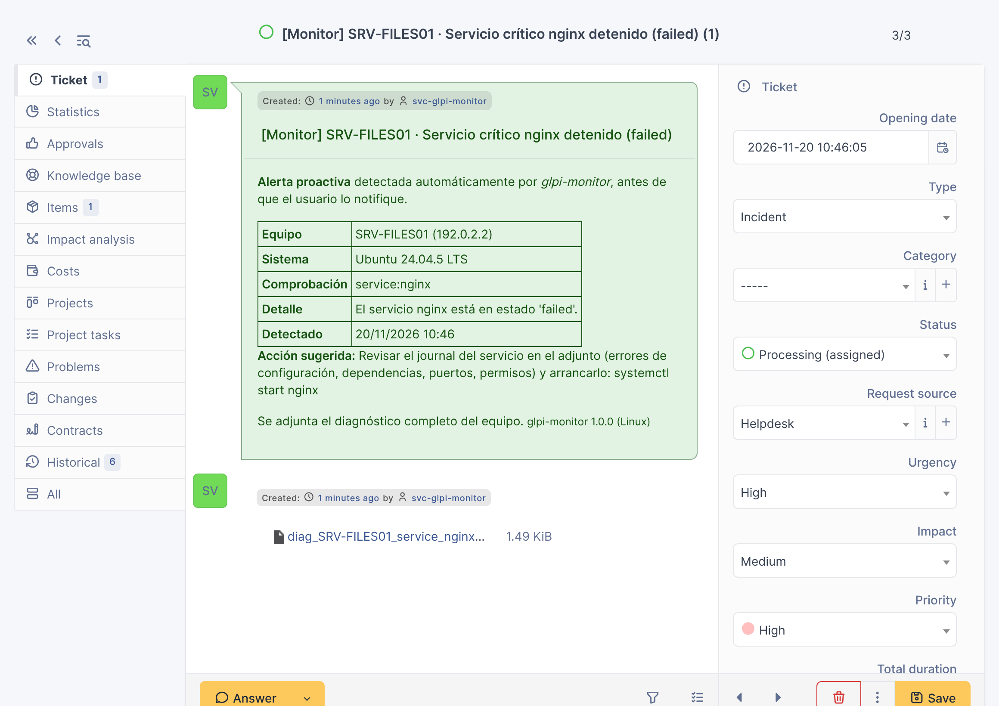
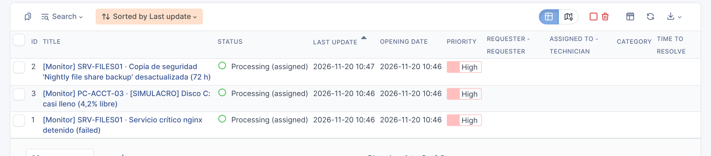
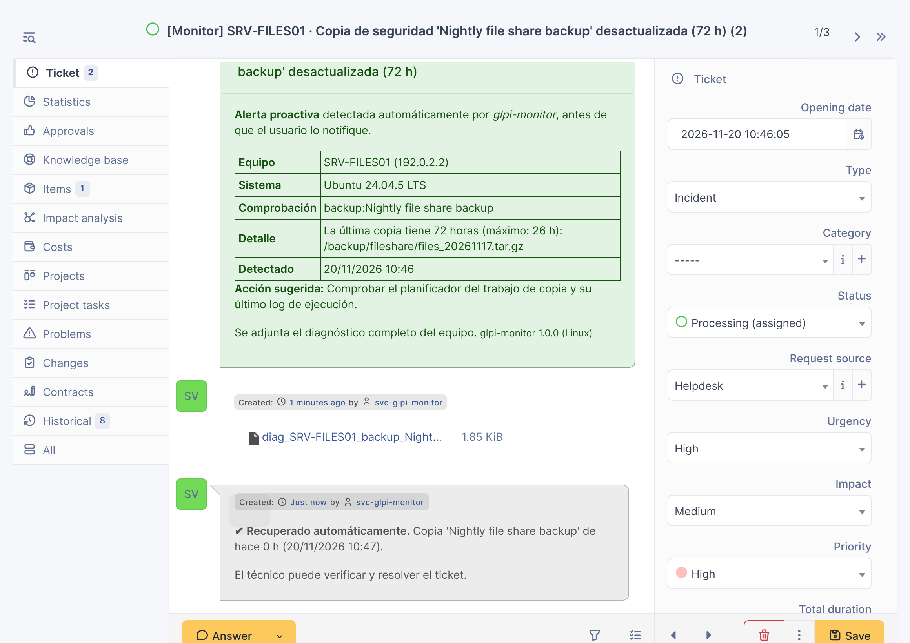

# GLPI Proactive Monitor

Lightweight health agents for Windows and Linux that **open a GLPI ticket before the user calls**. Every hour they check free disk space, critical services, reboots that have been pending for weeks and the age of the last backup. When something is wrong they create an incident through the GLPI REST API, link it to the computer in the inventory, assign it to the right team and attach a full diagnostic file, so the technician starts with the evidence instead of with a phone call.


> **Built with AI assistance (Claude Code).** I defined the problem, the checks and the ticket workflow from my own GLPI 11 deployment, and I validated the result in a lab running the official GLPI 11 image. What was and was not tested is listed honestly in [Tested](#tested).



<sub>Real ticket created by the Linux agent in the lab: the service is down, the computer is linked, the ticket is already assigned to the N2 group and the diagnostic is attached.</sub>

---

## Why it exists

I run **GLPI 11 in production** as the service desk and asset inventory. Like in most small IT teams, almost every ticket was **reactive**: the user notices the problem, calls, and only then someone starts looking. The silent failures behind many of those calls are well known:

- A disk reaches 100 % and an application, a print queue or a database stops. The disk had been filling up for weeks.
- A service (antivirus, print spooler, a business application) stopped after an update and nobody noticed until somebody needed it.
- Windows Update installed security patches **weeks ago**, but the machine was never restarted, so the patches were not actually active. That is a security exposure nobody sees.
- A backup job had been failing silently for days. You find out the day you need to restore.

None of these are hard problems. They are **visibility** problems: the signal exists on the machine, but it never reaches the service desk. GLPI already had everything needed to manage the work (tickets, inventory, groups, SLAs); it was only missing the input.

So the question became: **can the computers report their own problems into GLPI, with the evidence, before anyone is affected?**

### Goals

- **Proactive, not reactive:** detect the four most common silent failures and open the ticket automatically.
- **Useful tickets, not alerts:** each ticket says what failed, on which computer, what to do first, and carries a diagnostic file with the logs that matter for that failure.
- **No noise:** one ticket per problem. No duplicates every hour, a follow-up if it lasts, an automatic note when it recovers.
- **Lightweight:** a single script per OS, using only what Windows and Linux already include. No server to maintain, no agent to buy.
- **Secure by default:** least-privilege API user, encrypted tokens, HTTPS only.
- **Measurable:** tickets carry their own request source, so GLPI can report how many incidents were caught before the user called.

## What it checks

| Check | Fails when | GLPI urgency | Evidence attached |
|---|---|---|---|
| **Disk** | A fixed volume has less than 10 % free (5 % = critical). Thresholds configurable. | High · Very high | Disk table, the usual space eaters (`Windows\Temp`, `SoftwareDistribution`, Recycle Bin, user temp folders, CBS logs / `du` of the biggest folders, deleted-but-open files on Linux) |
| **Critical services** | A listed service is stopped or does not exist. Optional auto-restart: if the restart works, a low-urgency ticket is still opened to investigate the root cause. | High (Low if auto-restarted) | Service configuration, Service Control Manager events of the last 7 days / `systemctl status` and the unit journal |
| **Pending reboot** | A reboot has been pending for more than 14 days (Windows Update, CBS, pending rename / `reboot-required`, `needs-restarting`). Optional maximum uptime. | Medium | Reasons, last installed hotfixes, Windows Update events / packages that require the reboot |
| **Backups** | The newest backup file is older than N hours or is empty; Windows Server Backup reports a failure; or the success event of your backup software is missing. | High | Listing of the backup destination, `Get-WBSummary` / `Get-WBJob`, recent events |

Every diagnostic file also includes a system summary (OS, IPs, uptime, logged-on user, RAM), the automatic services that are stopped and the critical System errors of the last 24 h.

## What the technician sees



The diagnostic attached to the nginx ticket above. The cause (a missing certificate) is on the second screen, before anyone opens a remote session:

```text
Diagnóstico generado por glpi-monitor 1.0.0
Equipo:   SRV-FILES01
Uptime:   up 25 minutes

===== systemctl status nginx =====
× nginx.service - A high performance web server and a reverse proxy server
     Active: failed (Result: exit-code) since Fri 2026-11-20 09:12:01 UTC; 1h 25min ago

===== Journal de nginx (últimas 150 líneas) =====
nginx[41872]: nginx: [emerg] cannot load certificate "/etc/ssl/certs/intranet.crt": BIO_new_file() failed
nginx[41872]: nginx: configuration file /etc/nginx/nginx.conf test failed
```

When the problem goes away, the agent adds a follow-up instead of leaving a stale ticket behind:



> **Language.** The tickets, diagnostics and logs are written in **Spanish**, because they are read by a Spanish-speaking service desk. All the texts are plain strings in the two scripts, easy to translate.

## Ticket lifecycle

The agents keep a small `state.json` with the ticket opened for each problem. That is what keeps GLPI clean:

| Situation | What the agent does |
|---|---|
| New failure | Opens an incident: computer linked, urgency set, optional group / category / request source, diagnostic attached. |
| Same failure on the next run, ticket still open | Nothing. No duplicates. |
| Failure still there after 24 h (configurable) | Adds a *"the problem continues"* follow-up with a fresh diagnostic. |
| Failure gone | Adds a *"recovered automatically"* follow-up. The technician verifies and solves it. |
| Ticket solved by a technician but the failure comes back | Opens a **new** ticket (it is a recurrence, and that is useful for problem management). |
| GLPI unreachable | Logs the error locally. Nothing is recorded, so the next run tries again. |
| Many failures at once (bad GPO, broken update) | At most 5 tickets per run, the rest wait for the next run. Prevents a ticket storm. |
| Everything healthy | **No connection to GLPI at all.** |

## Quick start

> 🇪🇸 Step-by-step installation and test manual in Spanish: [docs/MANUAL-ES.md](docs/MANUAL-ES.md).

### 1. Prepare GLPI

Create the API client, the least-privilege profile and the technical user: [docs/GLPI-setup.md](docs/GLPI-setup.md) (about 10 minutes).

Want to try it first without touching production? The lab starts a real GLPI 11 in Docker and configures everything automatically:

```bash
cd lab
./setup-lab.sh        # prints the URL and the two tokens at the end
```

### 2a. Windows (workstations and servers)

Run as administrator on the target, from the `windows` folder:

```powershell
.\Install-GlpiMonitor.ps1 -GlpiUrl https://glpi.example.local/apirest.php
# asks for the App-Token and User-Token (hidden input), installs, and tests the connection
```

Then edit `C:\ProgramData\GlpiMonitor\config.json` (critical services, backup checks, group) and validate:

```powershell
$m = 'C:\ProgramData\GlpiMonitor\GlpiMonitor.ps1'
& $m -DryRun          # runs the real checks, shows what it would send, touches nothing
& $m -Simulate all    # creates 4 test tickets marked [SIMULACRO] to validate the GLPI side
& $m                  # normal run; it also closes the simulation (adds "recovered" follow-ups)
```

### 2b. Linux

```bash
sudo apt install curl jq           # or dnf
cd linux && sudo ./install.sh      # installs the script and a systemd timer (hourly, random delay)
sudo nano /etc/glpi-monitor/glpi-monitor.conf
sudo glpi-monitor --test
sudo glpi-monitor --dry-run
sudo glpi-monitor --simulate all
```

### Options

| Windows | Linux | Meaning |
|---|---|---|
| `-ConfigPath` | `-c, --config` | Configuration file (default `C:\ProgramData\GlpiMonitor\config.json` / `/etc/glpi-monitor/glpi-monitor.conf`). |
| `-TestConnection` | `-t, --test` | Log in to GLPI, look up the computer in the inventory, log out. |
| `-DryRun` | `-n, --dry-run` | Run the checks and print the tickets it would open. No API calls, no state changes. |
| `-Simulate all\|disk\|service\|reboot\|backup` | `-s, --simulate ...` | Fake failures marked `[SIMULACRO]`. They are closed automatically by the next normal run. |

Exit codes (both agents): `0` all healthy · `1` failures found and handled · `2` configuration or API error. Useful if you also want to watch the agent itself from another tool.

## Configuration

Windows uses `config.json` ([example](windows/config.example.json)); Linux uses a shell file ([example](linux/glpi-monitor.conf.example)). Same options on both:

| Setting | Default | Notes |
|---|---|---|
| GLPI URL, App-Token, User-Token | — | HTTPS required (plain HTTP is only accepted for `localhost`, for the lab). On Windows the installer stores the tokens encrypted. |
| Computer name | hostname | Must match the name in the GLPI inventory to link the ticket. If it is not found, the ticket is still created, unlinked. |
| Entity, category, request source, assigned group | not set | GLPI IDs. See [docs/GLPI-setup.md](docs/GLPI-setup.md#5-optional-route-the-tickets). |
| Disk free % / critical % | 10 / 5 | Excluded drives (Windows) or filesystem types (Linux). |
| Critical services | Spooler, EventLog, Dnscache / ssh, cron | Put here what matters to the business: `MSSQLSERVER`, the ERP service, `nginx`, `postgresql`... |
| Auto-restart services | off | Tries once before escalating. Never touches a *Disabled* service. |
| Pending reboot max days / max uptime | 14 / off | |
| Backups | none | Windows: `File` (newest file matching a path, UNC and `%COMPUTERNAME%` allowed), `WindowsServerBackup`, `EventLog` (success event ID of your backup software). Linux: `"Name|/path/pattern*|hours"`. |
| Follow-up every N hours | 24 | |
| Notify recovery | on | |
| Max tickets per run | 5 | |

## How it works

```
 Windows PC / server              Linux server
 ┌────────────────────────┐       ┌────────────────────────┐
 │ Scheduled task (SYSTEM)│       │ systemd timer (root)   │
 │ GlpiMonitor.ps1        │       │ glpi-monitor.sh        │
 │ checks → state.json    │       │ checks → state.json    │
 └───────────┬────────────┘       └───────────┬────────────┘
             │    HTTPS, only when needed     │
             └───────────────┬────────────────┘
                             ▼
        GLPI 11 · apirest.php (legacy REST API)
   ticket + linked computer + diagnostic + follow-ups
                             ▼
           Service desk: group "Sistemas N2"
```

1. **Run.** A scheduled task (Windows, as `SYSTEM`) or a systemd timer (Linux) starts the agent every hour, with a random delay of up to 10 minutes so a whole fleet does not hit GLPI in the same second. A mutex / `flock` prevents overlapping runs.
2. **Check.** The four checks produce a list of results, each with a stable key (`disk:C:`, `service:Spooler`, `reboot`, `backup:<name>`). A check that crashes is logged and does not stop the others.
3. **Compare with the state.** Each failing key is compared with `state.json` to decide: new ticket, nothing, follow-up, or new ticket after a recurrence. Recovered keys get their follow-up.
4. **Talk to GLPI only if needed.** The API session is opened lazily, on the first action, and always closed at the end.
5. **Collect the evidence** for that specific failure only when a ticket or follow-up is about to be sent, so healthy runs cost almost nothing.

The API calls, all through the legacy REST API of GLPI 11:

| Step | Call |
|---|---|
| Log in | `GET /initSession` with `App-Token` + `Authorization: user_token ...` |
| Find the computer | `GET /Computer?searchText[name]=<host>` (exact match checked client-side) |
| Create the ticket, linked to the computer | `POST /Ticket` with `items_id: {"Computer": [id]}`, `urgency`, `_groups_id_assign`... |
| Attach the diagnostic | `POST /Document` (multipart, `uploadManifest` with `itemtype: Ticket` and `items_id`) |
| Is the ticket still open? | `GET /Ticket/<id>` → `status` < 5 |
| Follow-up | `POST /ITILFollowup` |
| Log out | `GET /killSession` |

The Windows agent targets **Windows PowerShell 5.1** (what every Windows 10/11 and Server ships with), so it uses .NET `HttpClient` directly for the multipart upload instead of `Invoke-RestMethod -Form`, which only exists in PowerShell 7.

## Security

A script that runs as `SYSTEM` on every computer and holds credentials deserves care. What was done:

- **Least privilege in GLPI.** The API user can create tickets, read only its own, add follow-ups, upload documents and read computers. Nothing else. See the [rights table](docs/GLPI-setup.md#3-create-the-least-privilege-profile).
- **Two tokens and an IP filter.** The App-Token is bound to an API client restricted to the internal IP range; a leaked user token alone is useless from outside.
- **Tokens encrypted at rest on Windows** with DPAPI (machine scope): `config.json` copied to another computer cannot be decrypted. The install folder is restricted to `SYSTEM` and `Administrators` (set by SID, so it also works on Spanish Windows where the group is called *Administradores*).
- **Tokens never typed on the command line.** The installer asks for them with hidden input, so they do not end up in the PowerShell history. On Linux, curl reads them from a `600` header file instead of arguments, so other local users cannot see them with `ps`.
- **The Linux config is only sourced if it is safe.** It is a shell file, so the agent refuses to load it if anyone other than its owner can write to it, and warns if others can read it.
- **HTTPS only**, TLS 1.2 forced on PowerShell 5.1, certificate verification never disabled (an internal CA can be provided on Linux).
- **No retries on POST**, so a timeout can never create the same ticket twice.
- **HTML-escaped ticket content.** Anything coming from the machine (service names, paths, event messages) is encoded before it goes into the ticket.

Known limits and residual risk:

- Every agent shares the same GLPI user. If one machine is fully compromised as admin, the attacker can read that token and open tickets, or read the tickets the monitor created (which contain diagnostics of other machines). The least-privilege profile limits the damage to that. The proper fix is a small central collector holding the only token (see Roadmap).
- **Do not deploy the installer with the tokens through a GPO startup script**: SYSVOL is readable by every domain user. Use Intune, PDQ, SCCM, or run the installer interactively / remotely.
- The scheduled task uses `-ExecutionPolicy Bypass`. In a stricter environment, sign `GlpiMonitor.ps1` with your internal code-signing certificate and switch to `AllSigned`.

## Backups of the GLPI server itself

`backup/glpi-backup.sh` (with a nightly systemd timer, `backup/install.sh`) backs up the GLPI server the monitor reports to: a consistent `mariadb-dump` of the database plus `config/` (including **`glpicrypt.key`**, without which restored API tokens and stored passwords cannot be decrypted), `files/` (attachments), `marketplace/` and `plugins/`. Cache, sessions and temp folders are excluded (active user sessions do not belong in a backup). Files are written as `*.partial` and only renamed after `gzip -t` and a `Dump completed` check, so a failed run never leaves something that looks like a good backup; old copies are rotated and an optional off-site folder (NAS) gets a copy too. The monitor's backup check then opens a ticket if a nightly copy is missing.

**Restore tested:** a backup taken from the lab GLPI 11.0.13 was restored into a brand-new, empty database and GLPI instance. All tickets and attachments came back, and the **same API tokens** worked against the restored instance, which proves the encryption key was restored correctly. The restore steps are in [docs/MANUAL-ES.md](docs/MANUAL-ES.md#84-restaurar-también-sirve-para-migrar-a-otro-servidor) (Spanish).

## Rollout approach

The same incremental approach I use for anything that runs on every machine:

1. **Lab.** `lab/setup-lab.sh`, then `-Simulate all` to see real tickets in a disposable GLPI.
2. **GLPI production setup** with the least-privilege user ([docs/GLPI-setup.md](docs/GLPI-setup.md)).
3. **One pilot machine:** `-TestConnection`, `-DryRun`, `-Simulate all`, then one normal run that closes the simulation.
4. **A small group** for a week, to tune thresholds and the service list (this is where false positives show up).
5. **Everyone.** Measure it in GLPI by request source: proactive tickets vs. tickets opened by phone.

## Tested

Everything below ran against **GLPI 11.0.13** (official `glpi/glpi:11.0` Docker image + MariaDB 11.4), using the **least-privilege API user**, not an administrator.

- **Linux agent, end to end.** Disk below threshold, service stopped, service that does not exist, stale backup, empty-backup path, pending reboot dated from `/var/run/reboot-required`, ticket storm limit (6 failures → 5 tickets, 1 deferred to the next run), no duplicates on the second run, 24 h follow-up with a fresh attachment, recovery follow-up, new ticket after a technician solved it but the failure came back, group assignment, simulation and its automatic closure. Tickets, links, attachments and follow-ups were checked in the GLPI web UI and in the database. `shellcheck` clean. (The container has no systemd, so `systemctl`/`journalctl` were stubbed to play a failed nginx; the screenshots come from that run.)
- **Linux agent on a real server.** Deployed on the Ubuntu Server 24.04 VM that hosts a real GLPI 11.0.13 (Apache, MariaDB, real **systemd**, no stubs), running against `localhost`: connection test, dry-run of the real checks (`/`, `/boot`, `apache2`, `mariadb`, `cron`, pending reboot), simulation with 4 tickets and attachments, no duplicates on the second run, recovery follow-ups, and a **real failure**: `cron` stopped → restarted by the agent → low-urgency ticket opened → recovery follow-up on the next run. The systemd timer schedules the hourly runs. This deployment also found a misleading message (a missing *See all* right on computers was reported as "computer not found"); both agents now report `ERROR_RIGHT_MISSING` with the exact fix.
- **Backup and reboot on the same real server.** `glpi-backup` was installed as a systemd timer and its first run produced a verified database dump and a files archive including `glpicrypt.key`. Before it was installed, the monitor had already been configured to watch the backup folder and **correctly reported both backups as missing**; after the first run both checks turned OK. The server was then fully patched and **rebooted**: Apache, MariaDB, cron and both timers (monitor and backup) came back on their own and the dry-run reported 8 checks, 0 failures.
- **Windows agent, API side.** Run in **PowerShell 7 on Linux** against the same GLPI: syntax parse of both scripts, `-TestConnection`, `-DryRun`, `-Simulate`, ticket creation with linked computer and group, the multipart document upload, deduplication, recovery follow-ups and the `File` backup check. These tests found and fixed two real bugs (a PowerShell case-insensitive variable collision and an array-unwrapping issue). **PSScriptAnalyzer** reports 0 findings with [`windows/PSScriptAnalyzerSettings.psd1`](windows/PSScriptAnalyzerSettings.psd1), which documents the three style rules excluded on purpose.
- **Not tested yet on a real Windows machine:** the Windows-only parts, i.e. the CIM disk check, `Get-Service`, pending-reboot registry keys, Event Log queries, Windows Server Backup, DPAPI, the ACL and scheduled task from the installer, and running under **Windows PowerShell 5.1** specifically. That is exactly why the rollout starts with `-DryRun` on one pilot machine. If something fails there, please open an issue.

## Roadmap

- Move to the **GLPI 11 high-level API** (`/api.php`, OAuth2 client credentials) once it covers document uploads the same way.
- **Central collector** mode: agents send results to one internal service that holds the only GLPI token.
- More checks: certificate expiry, Defender/AV status, BitLocker, SMART disk health, Windows Update last success.
- English / Spanish ticket text selectable in the config.

## Troubleshooting

| Symptom | Likely cause |
|---|---|
| `ERROR_WRONG_APP_TOKEN_PARAMETER` | Wrong App-Token. |
| `ERROR_NOT_ALLOWED_IP` | The machine's IP is outside the range of the API client. |
| `ERROR_GLPI_LOGIN_USER_TOKEN` | Wrong or regenerated user token. |
| `ERROR_RIGHT_MISSING` / HTTP 403 | The API user's profile lacks a right from the table in [docs/GLPI-setup.md](docs/GLPI-setup.md), or it is not active on the right entity. |
| `API disabled` | *Enable Legacy REST API* is off in Setup > General > API. |
| Ticket created but not linked to the computer | The computer name in GLPI differs from the hostname: set `ComputerName` / `COMPUTER_NAME`. |
| Backup check fails with *access denied* on a UNC path | The task runs as `SYSTEM`, which uses the **computer account** (`DOMAIN\PC01$`) on the network: give it read access to the share. |
| "No se pudieron descifrar los tokens" | `config.json` was copied from another computer. Run the installer again on this one. |
| Nothing happens and the log is empty | Check the task in Task Scheduler (`\GlpiMonitor\`) or `systemctl list-timers glpi-monitor.timer`. |

Logs: `C:\ProgramData\GlpiMonitor\GlpiMonitor.log` (rotated at 5 MB) and `/var/log/glpi-monitor.log`.

## Repository layout

```
windows/   GlpiMonitor.ps1 (agent) · Install-GlpiMonitor.ps1 · config.example.json · PSScriptAnalyzerSettings.psd1
linux/     glpi-monitor.sh (agent) · install.sh (systemd timer) · glpi-monitor.conf.example
backup/    glpi-backup.sh · install.sh (nightly systemd timer) · glpi-backup.conf.example
lab/       docker-compose.yml + setup-lab.sh: GLPI 11 configured for the monitor in one command
docs/      GLPI-setup.md · MANUAL-ES.md (Spanish install & test guide) · screenshots
```

## License

MIT. See [LICENSE](LICENSE).
